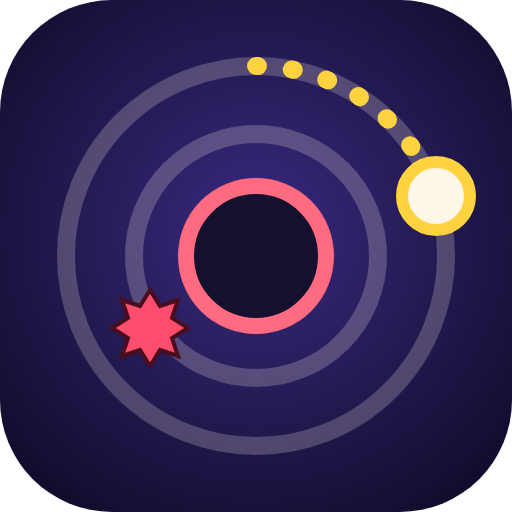
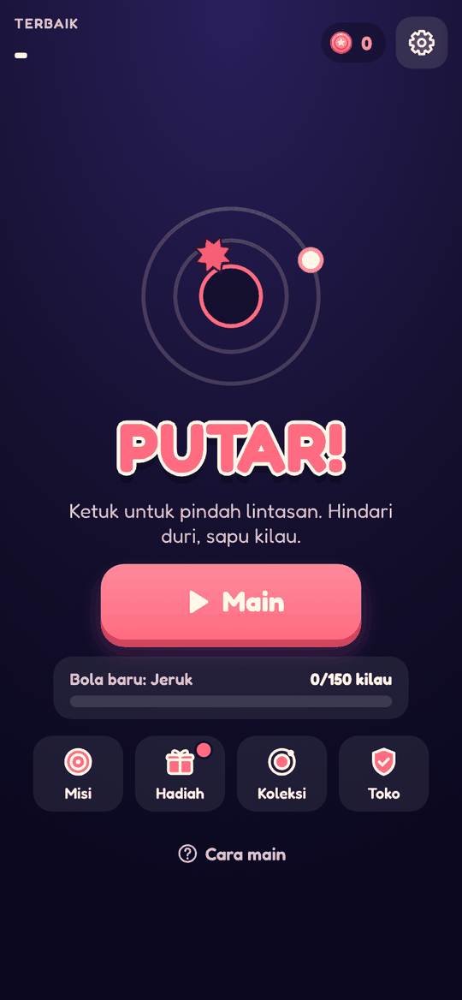
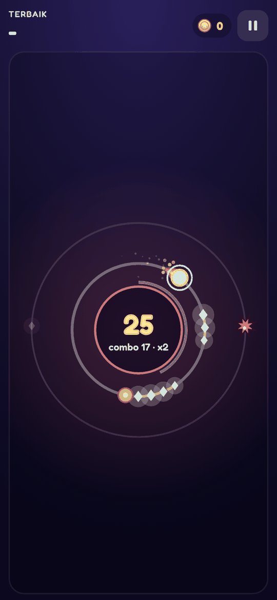
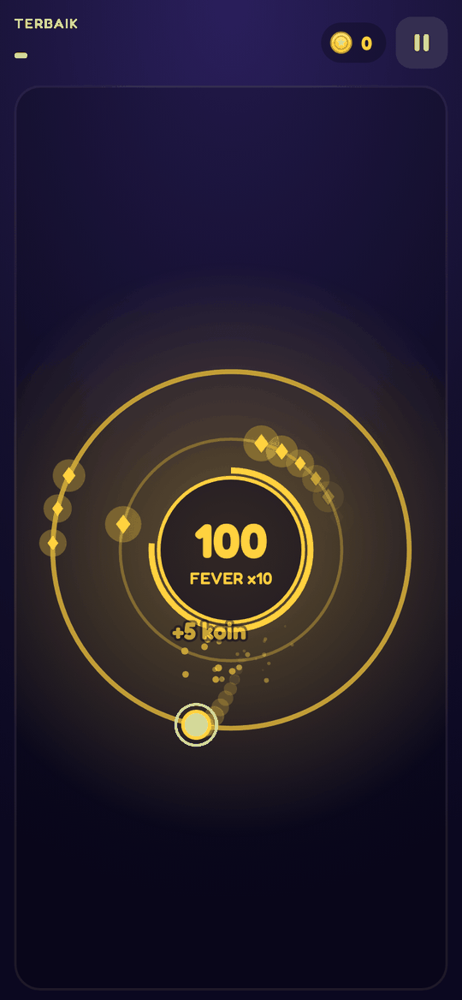
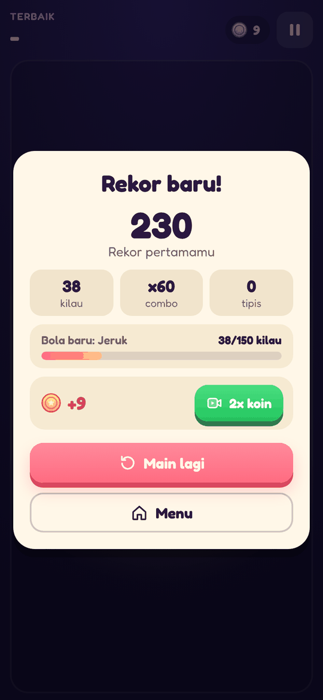

<div align="center">



# PUTAR!

**Satu ketukan, dua lintasan.**
Bola berputar mengelilingi inti. Ketuk untuk pindah lintasan, hindari duri, sapu kilau, dan kejar rekor.

[](https://lav-studio-org.github.io/putar/)

[](https://github.com/Lav-Studio-Org/putar/actions/workflows/test.yml)
[](https://github.com/Lav-Studio-Org/putar/actions/workflows/pages.yml)
[](https://github.com/Lav-Studio-Org/putar/releases)







</div>

## Cara main

1. Bola berputar sendiri. Ketuk di mana saja untuk pindah lintasan (dalam / luar).
2. Hindari duri merah. Sapu kilau berturut-turut untuk **combo**: skor per kilau naik sampai 5x, dan nadanya terus naik.
3. Kilau yang terlewat memutus combo. Pindah tepat sebelum duri memberi bonus **Tipis!**
4. Combo 40 memicu **FEVER**: semua duri jadi kilau selama 5 detik, skor 2x.
5. Kecepatan naik terus. Berapa lama kamu bertahan?

## Fitur

- **Ronde pendek, restart instan**, rekor diumumkan di tengah ronde.
- **Hidupkan lagi** sekali per ronde dan **perisai** sebelum ronde (koin atau iklan berhadiah).
- **Misi harian**, **hadiah harian 7 hari**, dan **koleksi 8 bola** yang terbuka dari total kilau.
- **Selalu bisa dilewati**: generator pola dibuktikan dengan bot sempurna di 300 seed.
- **Suara dan musik sintetis**, PWA offline. Riset desain di [docs/RISET.md](docs/RISET.md).

## Teknologi

HTML, CSS, dan JavaScript biasa. Tanpa build step, tanpa framework, tanpa library. Dunia game tetap 360 × 640 sehingga sama di semua layar. Dibuat dari [game-playbook](https://github.com/Lav-Studio-Org/game-playbook).

| Path | Isi |
|---|---|
| `index.html`, `style.css` | Layar, sprite ikon `#i-*`, token warna |
| `js/engine.js` | Logika murni tanpa DOM: lintasan, generator pola, combo, FEVER, misi |
| `js/meta.js` | Profil, koin, hadiah harian, misi, koleksi bola, `track()` |
| `js/audio.js` | Efek suara dan musik (Web Audio) |
| `js/ads.js` | Lapisan iklan `PT.Ads` (iklan contoh di web) |
| `js/native.js`, `js/ads-config.js` | AdMob untuk versi Android (tidak aktif di web) |
| `js/game.js` | Alur game, canvas, dan UI |
| `scripts/` | Bot simulasi, tes logika, balancing, smoke test, cek emoji, render ikon |

### Iklan

Placement berhadiah: `revive`, `double_coins`, `daily_double`, `shield_start`, `mission_double`. Interstitial `round_end` hanya di antara ronde: tidak di 3 game pertama, paling sering tiap 2 ronde, minimal 90 detik dari iklan lain.

## Jalankan lokal

```sh
git clone https://github.com/Lav-Studio-Org/putar.git
cd putar
python3 -m http.server 8123   # lalu buka http://localhost:8123/
```

### Tes dan skrip

```sh
node scripts/test-engine.js         # tes logika + bukti selalu bisa dilewati
node scripts/check-no-emoji.js      # tidak boleh ada emoji sebagai ikon
node scripts/balance.js 400         # simulasi pemain, target misi (--write untuk menyimpan)
node scripts/smoke.js http://localhost:8123/ shots   # Playwright: main beberapa ronde + screenshot
node scripts/icons.js               # render icon.svg ke PNG
```

## Deploy dan rilis

- Setiap push ke `main` disalin ke branch `gh-pages` oleh `.github/workflows/pages.yml`, lalu disajikan di https://lav-studio-org.github.io/putar/.
- Rilis: naikkan `VERSION`, tambah `docs/releases/v<versi>.md`, naikkan `CACHE` di `sw.js`. Workflow `release.yml` membuat GitHub Release.

## Lisensi aset

Font Fredoka (SIL Open Font License). Semua grafis dan suara dibuat sendiri di kode.
